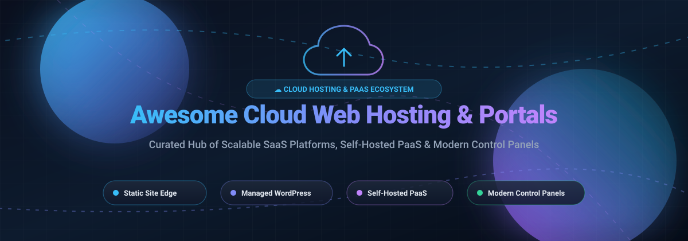

  

# ☁️ Awesome Cloud Web Hosting & Web Portal Ecosystem 🌐

  <strong>A curated discovery guide to top-tier cloud web hosting, serverless edge deployment platforms, self-hosted PaaS, and modern web hosting control panels.</strong>

  
  
  
  
  
  
  

  <em>⚡ Focused on Static Site Hosting, Serverless Edge Deploys, Managed WordPress &amp; Cloud Application Infrastructure ⚡</em> 
  <strong>📅 Last updated: March 2026</strong>

---

## 📖 Introduction & Ecosystem Overview

Welcome to the **Awesome Cloud Web Hosting & Web Portal Ecosystem** repository! 🚀

Finding the ideal hosting environment for websites and web applications can be daunting given the rapid evolution of cloud infrastructure, edge computing, and self-hosted tooling. This resource tracks the industry's premier **SaaS hosting platforms**, **open-source Platform as a Service (PaaS)** alternatives, and **self-hosted web hosting control panels**.

Whether you require enterprise-grade reliability, lightning-fast edge static deployments, high-performance managed WordPress infrastructure, or privacy-respecting self-hosted control panels to run on bare-metal or VPS instances without vendor lock-in, this curated guide provides clear comparisons on starting tiers, exact free tier allowances, company scale, and community popularity.

---

## 📑 Table of Contents
- [📖 Introduction & Ecosystem Overview](#-introduction--ecosystem-overview)
- [📊 Sector Overview & Market Dynamics](#-sector-overview--market-dynamics)
- [🏢 SaaS / Hosted Platforms](#-saas--hosted-platforms)
- [💻 Open-Source GitHub Projects](#-open-source-github-projects)
- [🤝 How to Contribute](#-how-to-contribute)
- [💖 Support & Sponsorship](#-support--sponsorship)
- [📈 Star History](#-star-history)
- [⚠️ Disclaimer](#️-disclaimer)

---

## 📊 Sector Overview & Market Dynamics

The global **cloud web hosting and web hosting services market** is estimated at **$135 billion in 2025** and is projected to expand to over **$250 billion by 2031**, growing at a robust **CAGR of ~10.5%**. This rapid expansion is fueled by enterprise cloud migration, developer-centric serverless edge architectures, Jamstack platforms, and managed WordPress adoption.

The sector is **moderately fragmented**:
* **Hyperscalers (IaaS)**: Tech giants including Microsoft Azure, Amazon Web Services (AWS), and Google Cloud Platform (GCP) provide the fundamental compute and global networking backbones, collectively holding over 60% of cloud infrastructure revenues.
* **Specialized SaaS & PaaS Layer**: Despite hyperscaler scale, no single vendor captures a winner-take-all monopoly over web application hosting. Specialized platforms (such as Cloudflare Pages, Vercel, Netlify, WP Engine, and Kinsta) capture substantial developer loyalty by delivering refined developer experience (DX), instant Git deployments, global CDNs, and zero-maintenance automation.
* **Self-Hosted & Open-Source Shift**: Rising egress fees and SaaS subscription fatigue have accelerated adoption of self-hosted PaaS engines (such as Coolify, Dokku, and CapRover) and control panels (like HestiaCP and CloudPanel), enabling developers to achieve data sovereignty and predictable hosting costs.

---

## 🏢 SaaS / Hosted Platforms

Below is a detailed comparison of industry-leading cloud hosting and web portal SaaS platforms, sorted in descending order by estimated company valuation / revenue scale:

| Product | Company Size / Valuation / Revenue | Description | Pricing (Starting Tier) | Free Tier / Trial Limits |
|---|---|---|---|---|
| **[Microsoft Azure App Service](https://azure.microsoft.com/en-us/products/app-service/)** | ~$3.1T Market Cap (~$110B+ Intelligent Cloud Annual Revenue) | Enterprise-grade managed web app hosting with auto-scaling, deployment slots, custom domains, and VNet integration. Supports .NET, Java, Node.js, Python, and PHP. | Basic (B1): ~$13.14/month; Standard (S1): ~$73/month (F1 is free) | **Free tier (F1)**: 60 CPU minutes/day, shared compute, 1 GB disk storage, 165 MB/day outbound data bandwidth; no custom domains or SLA |
| **[AWS Amplify](https://aws.amazon.com/amplify/)** | ~$2.2T Market Cap (~$107B+ AWS Annual Revenue Run Rate) | Fullstack web and mobile application hosting with continuous deployment (CI/CD), global CDN caching, and managed backend microservices. | Standard pay-as-you-go: $0.01 per build minute, $0.023/GB/month hosting storage, $0.15/GB data transfer | **12-month free trial**: 1,000 build minutes/month, 5 GB CDN storage, 15 GB data transfer/month; plus up to **$200 AWS credits** for 6 months for new accounts |
| **[Cloudflare Pages](https://pages.cloudflare.com/)** | ~$38B Market Cap (~$1.6B+ Annual Revenue) | Ultrafast Jamstack and static site edge hosting powered by Cloudflare's 300+ city global Anycast network and Workers runtime. | Pro: $20/month (5,000 builds/month, 100 custom domains); Business: $200/month | **Free for life plan**: Unlimited bandwidth, unlimited total sites, 500 builds/month, 100 custom domains per project, 1 concurrent build |
| **[Zoho Sites](https://www.zoho.com/sites/)** | ~$1.4B+ Annual Revenue (Privately held, $10B+ estimated valuation) | Zero-code drag-and-drop website builder and portal host seamlessly integrated into the Zoho business and CRM operating ecosystem. | Starter: $5/month (billed annually, includes 5 pages, 10 GB bandwidth, 500 MB storage) | **Free for life plan**: 1 hosted website, single page, 100 MB storage, 5 MB file size upload limit, Zoho branding banner |
| **[Vercel](https://vercel.com/)** | ~$3.25B Valuation (Series D, ~$100M+ ARR) | Leading frontend cloud platform optimized for Next.js, React, Svelte, static sites, and serverless edge functions with automatic Git CI/CD. | Pro: $20/seat/month (includes $20 usage credit, 1 TB bandwidth, preview environments) | **Hobby (Free for life, personal non-commercial)**: 100 GB fast data transfer/month, 1M edge requests, 4 CPU-hours active compute, 1M serverless function invocations |
| **[WP Engine](https://wpengine.com/)** | ~$500M+ Valuation (~$200M+ Annual Revenue, backed by Silver Lake) | Enterprise managed WordPress and WooCommerce hosting featuring automated daily backups, staging environments, and 24/7 WordPress engineering support. | Startup: $20/month (billed annually, 1 site, 25K visits/month, 10 GB storage, 50 GB bandwidth) | **No free tier**; offers **60-day money-back guarantee** on annual plans with full feature access during the refund window |
| **[Netlify](https://www.netlify.com/)** | ~$2B Valuation (Series D) | Composable web architecture and static hosting platform offering edge handlers, serverless functions, form processing, and Git deploys. | Pro: $20/seat/month (includes credit allowance for build minutes and bandwidth) | **Free tier (Free for life under credit allotment)**: 100 GB bandwidth/month, 300 build minutes/month, 25k edge invocations/month |
| **[Kinsta](https://kinsta.com/)** | ~$100M+ Estimated Annual Revenue (Bootstrapped / Privately held) | High-performance managed WordPress and cloud application hosting built on Google Cloud Platform's C2/C3D machines and Cloudflare enterprise edge. | WP 1 plan: $35/month (1 WordPress install, 25K visits/month, 10 GB storage, free CDN) | **No free tier**; offers **30-day money-back guarantee** with full platform capabilities and staging access |
| **[Bluehost](https://www.bluehost.com/)** | Subsidiary of Newfold Digital (~$1B+ Group Annual Revenue, Clearlake/Siris Capital) | Traditional shared, cPanel, VPS, and dedicated hosting solution with 1-click WordPress provisioning and bundled domain management. | Basic Shared Hosting: $2.95/month intro rate (renews at $11.99/month, 1 website, 10 GB SSD) | **No free tier**; offers **30-day money-back guarantee** on web hosting plans with free domain registration for the 1st year |

---

## 💻 Open-Source GitHub Projects

Explore the top open-source self-hosted PaaS solutions, application deployment runtimes, and web hosting server control panels. Sorted in descending order by GitHub community Stars_Counts:

| Project | Stars_Badge | Description |
|---|---|---|
| **[Coolify](https://github.com/coollabsio/coolify)** |  | Self-hosted Heroku/Vercel/Netlify alternative. Deploy static sites, Node.js, Python, PHP, and databases on your own VPS with Git integration and automatic SSL. |
| **[Dokku](https://github.com/dokku/dokku)** |  | Lightweight Heroku alternative. Git-push deployments to Docker containers on a single server. Battle-tested, extensible, and widely adopted PaaS. |
| **[CapRover](https://github.com/caprover/caprover)** |  | Scalable PaaS on Docker & Nginx. Deploy apps from Git or Docker images with an intuitive web GUI, automatic reverse proxy, and one-click app templates. |
| **[Piku](https://github.com/piku/piku)** |  | The tiniest self-hosted PaaS. Supports git push deployments for Python, Node, Go, and static sites to remote servers, VPS, and Raspberry Pis. |
| **[Webmin](https://github.com/webmin/webmin)** |  | Powerful and flexible web-based Unix/Linux system and server administration control panel with domain and Apache/Nginx hosting modules. |
| **[Tsuru](https://github.com/tsuru/tsuru)** |  | Open-source, extensible multi-tenant Platform as a Service (PaaS) built on top of Docker and Kubernetes for scalable production environments. |
| **[HestiaCP](https://github.com/hestiacp/hestiacp)** |  | Modern web server control panel for Debian/Ubuntu with Nginx/Apache, PHP-FPM, DNS, mail services, and Let's Encrypt SSL. |
| **[Kubero](https://github.com/kubero-dev/kubero)** |  | Lightweight self-hosted PaaS built for Kubernetes. Turn any K8s cluster into a Heroku-like hosting platform with GitOps deployment workflows. |
| **[aaPanel](https://github.com/aaPanel/aaPanel)** |  | Web hosting control panel with one-click LEMP/LAMP stack installation, file manager, and one-click app store for WordPress, Laravel, and more. |
| **[CloudPanel](https://github.com/cloudpanel-io/cloudpanel-ce)** |  | Modern PHP, Node.js, and static site server control panel powered by Nginx, MySQL, and multi-version PHP support optimized for cloud hosting. |
| **[Froxlor](https://github.com/froxlor/froxlor)** |  | Lightweight server management control panel developed by experienced system administrators to simplify multi-domain hosting management. |

💡 **Pro-Tip for Self-Hosters**: Combine **Coolify**, **Dokku**, or **CapRover** for Git-push application deployments, **Kubero** for Kubernetes clusters, and **CloudPanel** or **HestiaCP** for traditional multi-tenant web and email hosting—building a private, robust hosting ecosystem on modest VPS or dedicated infrastructure.

---

## 🤝 How to Contribute

Contributions are warmly welcomed! Help keep this awesome collection fresh and comprehensive:

1. 🍴 **Fork** the repository.
2. 🌿 Create a feature branch: `git checkout -b feature/new-hosting-entry`.
3. ✍️ Add or update entries in `README.md` following the established table structure.
4. 📋 Ensure entries contain accurate links, company scale, specific pricing, specific free tier limits, and GitHub Stars_Badges (for open source).
5. 🚀 Commit your improvements and open a Pull Request with a clear description.

---

## 💖 Support & Sponsorship

Thank you so much for taking the time to explore and use this project! 🌟

If this curated repository has saved you time, helped you evaluate hosting architectures, or inspired your infrastructure setup, please consider supporting the project:

- ⭐ **Star** this repository to help other developers find it.
- 🍴 **Fork** and share it with your developer community and colleagues.
- ☕ **Buy me a coffee / Sponsor**: If you'd like to support ongoing curation and open-source contributions, visit the [GitHub Sponsors Dashboard](https://github.com/sponsors/ishandutta2007).

Your backing and enthusiasm are deeply appreciated! ❤️

---

## 📈 Star History

---

## ⚠️ Disclaimer

- This is a **community-curated** list — not exhaustive and not a financial or technical endorsement.
- Web hosting platforms manage credentials, SSL certificates, DNS configurations, and critical user data; always configure strong multi-factor authentication, firewalls, automated off-site backups, and least-privilege role-based access.
- SaaS hosting fees scale with data transfer, build compute, and traffic spikes; review pricing calculators before deploying mission-critical production workloads.

---

  Built with ❤️ for developers, DevOps engineers, and system administrators building the open cloud.

